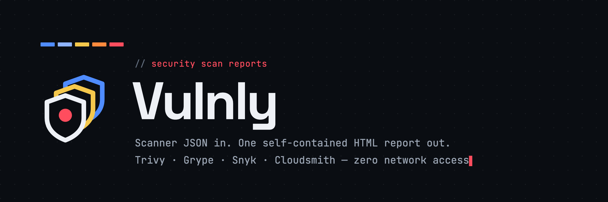
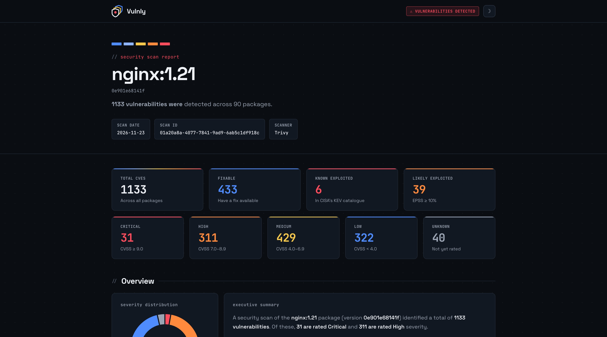
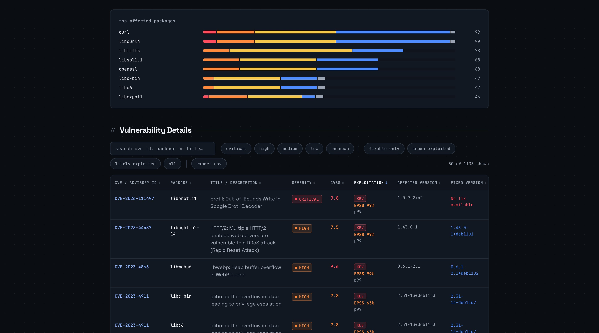

Generate self-contained HTML vulnerability reports from Cloudsmith, Trivy, Grype and Snyk.
Every report is a single file that opens with no network access.

<p align="center">
  <a href="https://pypi.org/project/vulnly/"></a>
  <a href="https://pypi.org/project/vulnly/"></a>
  <a href="https://pepy.tech/projects/vulnly"></a>
  <a href="https://pypi.org/project/vulnly/"></a>
  <a href="https://github.com/fullstackspectrum/homebrew-vulnly"></a>
  <a href="https://github.com/fullstackspectrum/vulnly/blob/main/LICENSE"></a>
</p>

## Installation

Install from PyPI:

```bash
pip install vulnly
```

Or with Homebrew on macOS and Linux:

```bash
brew install fullstackspectrum/vulnly/vulnly
```

## Features

- **Fully offline reports** — a single HTML file with fonts, charting library and logo embedded. No CDN, no web fonts, no outbound requests when opened, so reports work on airgapped hosts and keep working once archived
- Supports multiple scanner sources: **Cloudsmith** (both the v1 CLI scan output and the v2 OSV advisory API), **Trivy**, **Grype**, and **Snyk** (auto-detected or via `--source` flag)
- **Repository summary reports** — automatically detects Cloudsmith repo-level summaries and generates a dedicated overview report with package status breakdown, aggregate vulnerability counts, and per-package detail table
- Dark and light colour themes via `--theme` flag, plus an in-report toggle so readers can switch without regenerating
- Interactive doughnut charts showing severity or status distribution (Chart.js, bundled)
- **Know what to fix first** — every finding is checked against CISA's [Known Exploited Vulnerabilities](https://www.cisa.gov/known-exploited-vulnerabilities-catalog) catalogue and FIRST's [EPSS](https://www.first.org/epss/) scores, and the table opens in priority order: known exploited, then likely exploited, then severity
- **VEX** — `--vex` applies OpenVEX statements: findings ruled out leave the counts and are listed separately with their justification, so nothing disappears silently
- **CI gating** — `--fail-on kev,epss,critical,high,fixable` exits 1 when any of them occur
- Stat cards for the total, fixable, known exploited and likely exploited findings, then each severity
- Severity and score from CVSS vectors (3.x and 4.0) when a source gives only the vector
- **Top affected packages** — a ranked breakdown showing where findings are concentrated, since one bad dependency usually dominates a scan
- Auto-generated executive summary, with an alert that distinguishes urgent findings from routine ones and from a clean scan
- Client-side search, severity filters and fixable, known-exploited and likely-exploited toggles, with sortable columns and pagination so large reports stay usable
- **CSV export** of the current filtered view, safe to open in a spreadsheet
- Automatic linking for CVE IDs (NVD) and GHSA IDs (GitHub Advisories)
- Customisable logo — supply via `--logo`, embedded in the report as a data URI
- Accepts input from a file or stdin (`-`), making it easy to pipe from other tools
- Input validation with helpful warnings for malformed data
- Zero external dependencies — uses only the Python standard library

## Quick Start

```bash
vulnly sample_data.json
```

This reads `sample_data.json` and writes the report to `reports/` (the default output directory).

### Specify the scanner source

The tool auto-detects the input format, but you can be explicit:

```bash
vulnly scan.json --source trivy
vulnly scan.json --source grype
vulnly scan.json --source snyk
vulnly scan.json --source cloudsmith
vulnly scan.json --source cloudsmith-osv
```

If `--source` is specified and the input doesn't match the expected format, the tool exits with a clear error message.

### Repository summary reports

Cloudsmith repo-level summary JSON is automatically detected and generates a dedicated repository overview report:

```bash
vulnly repo_summary.json
```

The output includes package status cards (vulnerable / no issues / not scanned), aggregate vulnerability severity breakdown, a status distribution chart, and a searchable/filterable package table.

### Specify a custom output path

```bash
vulnly sample_data.json -o my_report.html
```

### Custom logo

Use the `--logo` flag to supply a custom logo image. It will be embedded directly in the HTML report header as a base64 data URI:

```bash
vulnly sample_data.json --logo my-company-logo.png
```

**Logo requirements:**

| Constraint | Limit |
|---|---|
| Max file size | 2 MB |
| Max dimensions | 512 × 512 px |
| Recommended size | 128 × 128 px to 256 × 256 px |
| Supported formats | `.png`, `.jpg`, `.jpeg`, `.gif`, `.svg`, `.webp`, `.ico` |

If a custom logo exceeds the file size or dimension limits, a warning is printed and the default Vulnly logo is used instead.

If no `--logo` is provided, the built-in Vulnly logo is used.

### Theme

Choose the theme the report opens in — dark is the default:

```bash
vulnly sample_data.json --theme light
vulnly sample_data.json --theme dark
```

Every report also carries both palettes, so readers can switch with the
toggle in the report header regardless of which theme it was generated in.
Their choice is remembered per browser.

### Read from stdin

Pipe JSON directly from another command:

```bash
cat scan_output.json | vulnly -
```

#### Cloudsmith CLI

Pipe vulnerability scan results directly from the Cloudsmith CLI:

```bash
cloudsmith vulnerabilities WORKSPACE/REPO/PACKAGE_IDENTIFIER --output-format json | vulnly -
```

#### Cloudsmith vulnerabilities API (v2, OSV)

The [v2 vulnerabilities endpoint](https://docs.cloudsmith.com/api/packages/vulnerabilities/list)
serves OSV advisory records for a package, and supersedes the v1 data the CLI
command returns. It answers with advisories alone and names no package, so
pass the package identity yourself:

```bash
curl -s -H "X-Api-Key: $CLOUDSMITH_API_KEY" \
  "https://api.cloudsmith.io/v2/packages/PACKAGE_SLUG_PERM/vulnerabilities/" \
| vulnly --source cloudsmith-osv - \
    --repository WORKSPACE/REPO --package log4j --package-version 2.14.1
```

The endpoint paginates (`page`, `page_size`) and filters server-side by
`threat_level`, `cvss_min`/`cvss_max`, `vulnerability_id` and `is_malware`.
Whatever a page contains is what the report covers, so raise `page_size` if
you want everything in one report.

#### Trivy

Scan an image with Trivy and pipe directly to Vulnly:

```bash
trivy image -f json nginx:latest | vulnly --source trivy -
```

#### Grype

Scan an image with Grype and pipe directly to Vulnly:

```bash
grype nginx:latest -o json | vulnly --source grype -
```

#### Snyk

Test a container image with Snyk and pipe directly to Vulnly:

```bash
snyk container test nginx:latest --json | vulnly --source snyk -
```

## Prioritising findings

A scan with a thousand findings doesn't need a thousand fixes this week. Vulnly
adds two signals to each finding with a CVE, and puts the table in that order:

- **Known exploited**: the CVE is in CISA's Known Exploited Vulnerabilities
  (KEV) catalogue, so it's being exploited in the wild. The row gets a `KEV`
  tag, with the date CISA added it and whether it's linked to ransomware.
- **Likely exploited**: FIRST's EPSS gives the probability the CVE is
  exploited in the next 30 days. 10% or more counts as likely; that's roughly
  the top 5% of all scored CVEs. Change it with `--epss-threshold`.

The table opens with known exploited findings first, then likely exploited,
then by severity, with EPSS and CVSS breaking ties. `--sort severity` keeps
the 1.2 order. The executive summary and alert lead with known exploited
findings when there are any.

GHSA and Snyk IDs are matched through the CVE aliases the scanner reports.

### Network and air-gapped hosts

KEV and EPSS are looked up when the report is generated, cached for a day in
`~/.cache/vulnly`, and embedded in the report, which still opens with no
network access. If a lookup fails, the report is generated anyway and says
the data is missing.

On a host with no internet access, download the data elsewhere and pass it in,
or turn the lookups off:

```bash
curl -LO https://www.cisa.gov/sites/default/files/feeds/known_exploited_vulnerabilities.json
curl -LO https://epss.empiricalsecurity.com/epss_scores-current.csv.gz
vulnly scan.json --kev known_exploited_vulnerabilities.json --epss epss_scores-current.csv.gz

vulnly scan.json --no-enrich        # or set VULNLY_NO_ENRICH=1
```

### VEX

If your team has decided some findings don't apply, record it in an
[OpenVEX](https://openvex.dev) document and pass it with `--vex` (repeatable):

```bash
vulnly scan.json --vex exceptions.openvex.json
```

Findings marked `not_affected` or `fixed` leave the counts, the chart and the
table, and are listed under the table with the statement's justification.
`under_investigation` findings stay, tagged. A statement that names packages
applies only to those packages. in-toto attestations and DSSE envelopes
wrapping OpenVEX are read too.

### CI gating

`--fail-on` exits 1 when any listed category occurs. The report is written
either way.

| Category | Fails when |
| --- | --- |
| `kev` | a finding is known exploited |
| `epss` | a finding is likely exploited (EPSS at or over the threshold) |
| `critical` | a finding is rated critical |
| `high` | a finding is rated critical or high |
| `fixable` | a finding has a fix available |

```bash
vulnly scan.json --fail-on kev,epss
```

A `kev` or `epss` gate fails, rather than passes, when that data couldn't be
looked up, so a network outage can't wave a build through.

## Example report

The scan summary for `nginx:1.21`: the total, fixable, known exploited and
likely exploited counts, then each severity, the distribution chart, and an
executive summary that leads with what's being exploited:



Further down, the findings themselves: where they're concentrated, then the
table in priority order, known exploited first, with KEV tags and EPSS scores,
search, severity, fixable and exploitation filters, and CSV export:



## Usage

```
usage: vulnly [-h] [-v] [-o OUTPUT] [--logo LOGO]
              [--theme {dark,light}] [--source SOURCE]
              [--package PACKAGE]
              [--package-version PACKAGE_VERSION]
              [--repository REPOSITORY] [--no-enrich] [--kev FILE]
              [--epss FILE] [--epss-threshold P]
              [--sort {priority,severity}] [--vex FILE]
              [--fail-on LIST]
              input

Generate an HTML vulnerability report from a JSON input file.

positional arguments:
  input                 Path to the JSON file containing vulnerability data
                        (use '-' for stdin)

options:
  -h, --help            show this help message and exit
  -v, --version         show program's version number and exit
  -o, --output OUTPUT   Output HTML file path (default: auto-generated from
                        package metadata)
  --logo LOGO           Path to a custom logo image (embedded in the report as
                        a data URI)
  --theme {dark,light}  Report colour theme (default: dark)
  --source SOURCE       Scanner source format: cloudsmith, cloudsmith-osv,
                        grype, snyk, trivy (auto-detected if omitted)
  --package PACKAGE     Package name to show in the report (overrides the
                        input)
  --package-version PACKAGE_VERSION
                        Package version to show in the report (overrides the
                        input)
  --repository REPOSITORY
                        Repository path to show in the report (overrides the
                        input)

prioritising:
  Findings are checked against CISA's Known Exploited Vulnerabilities
  catalogue and FIRST's EPSS scores, fetched when the report is generated
  (cached for a day) and embedded in it, so the report still opens offline.

  --no-enrich           don't look up KEV or EPSS (or set VULNLY_NO_ENRICH=1)
  --kev FILE            use a downloaded KEV catalogue (CISA's JSON) instead
                        of fetching it
  --epss FILE           use a downloaded EPSS file (FIRST's daily CSV, plain
                        or .gz) instead of the API
  --epss-threshold P    EPSS score that counts as likely exploited (default:
                        0.1, i.e. 10%)
  --sort {priority,severity}
                        table order: priority (known exploited, then likely
                        exploited, then severity; the default) or severity
  --vex FILE            apply an OpenVEX document: not_affected and fixed
                        findings leave the counts and are listed separately
                        (repeatable)
  --fail-on LIST        exit 1 if any of these occur: kev, epss, critical,
                        high, fixable (comma-separated; the report is still
                        written)
```

The three metadata flags override whatever the input format supplied. They
exist for `cloudsmith-osv`, whose payload is advisory data carrying no package
identity, but they apply to any source.

### Environment variables

| Variable | Effect |
| --- | --- |
| `VULNLY_NO_UPDATE_CHECK` | Set to any value to skip the PyPI version check. |
| `VULNLY_NO_ENRICH` | Set to any value to skip the KEV and EPSS lookups, like `--no-enrich`. |
| `VULNLY_CACHE_DIR` | Where KEV and EPSS lookups are cached (default `~/.cache/vulnly`, or `$XDG_CACHE_HOME/vulnly`). |

The version check is skipped automatically when stderr is not a terminal, so
it makes no network request in CI or when output is piped.

## Offline reports

A generated report is a single HTML file that makes **no network requests when
opened**. Everything it needs is embedded:

| Asset | Source | Licence |
| --- | --- | --- |
| Charting | Chart.js 4.4.0, bundled and inlined | MIT |
| Typography | Space Grotesk (300–700) and JetBrains Mono (100–800), variable fonts, latin subset | SIL OFL 1.1 |
| Logo | Embedded as a data URI | — |

This means reports render identically on airgapped hosts and in restricted
browser environments, and keep rendering years later when a CDN URL would have
moved. It also means opening a report tells no third party that you did.

CVE and GHSA identifiers still link out to NVD and GitHub Advisories, but those
are ordinary links — nothing is fetched unless the reader clicks one.

The generator itself contacts the network for the KEV and EPSS lookups
described in [Prioritising findings](#prioritising-findings), and for its PyPI
version check. Both can be turned off, with `VULNLY_NO_ENRICH` and
`VULNLY_NO_UPDATE_CHECK`.

## Input JSON Format

The generator accepts **multiple input formats** — it auto-detects which one you provide, or you can specify explicitly with `--source`.

### 1. Cloudsmith package format

Pass raw JSON output from the Cloudsmith CLI. The tool extracts namespace, repository, package metadata, scan target, and all vulnerabilities automatically.

The expected structure has a top-level `data` object containing `package`, `scans`, etc.:

```json
{
    "data": {
        "created_at": "2025-06-09T08:39:20.441354Z",
        "identifier": "TZR5N4HaO7nTclhz",
        "package": {
            "name": "log4j",
            "url": "https://example.com/packages/my-org/java/wAoMy00juV6N/",
            "version": "28a05d8e..."
        },
        "scans": [
            {
                "target": "Java",
                "type": "jar",
                "results": [
                    {
                        "vulnerability_id": "CVE-2021-45046",
                        "severity": "Critical",
                        "title": "DoS in log4j 2.x...",
                        "package_name": "org.apache.logging.log4j:log4j-core",
                        "affected_version": { "version": "2.8.1" },
                        "fixed_version": { "version": "2.16.0, 2.12.2" },
                        "cvss_scores": null
                    }
                ]
            }
        ]
    }
}
```

### 2. Cloudsmith OSV format (v2 API)

Pass the response from `GET /v2/packages/{package_slug_perm}/vulnerabilities/`.
The tool reads Cloudsmith's precomputed `best_severity` (falling back to the
raw OSV `severity` arrays), the affected package name and ecosystem, and the
version ranges:

```json
{
    "results": [
        {
            "id": "GHSA-jfh8-c2jp-5v3q",
            "summary": "Remote code execution in Log4j2 via JNDI lookup",
            "package_name": "org.apache.logging.log4j:log4j-core",
            "is_malware": false,
            "best_severity": {
                "type": "CVSS_V3",
                "label": "critical",
                "cvss": { "base_score": 10.0 }
            },
            "affected": [
                {
                    "package": {
                        "ecosystem": "Maven",
                        "name": "org.apache.logging.log4j:log4j-core"
                    },
                    "ranges": [
                        {
                            "type": "ECOSYSTEM",
                            "events": [
                                { "introduced": "2.0-beta9" },
                                { "fixed": "2.15.0" }
                            ]
                        }
                    ]
                }
            ]
        }
    ]
}
```

Two things differ from the v1 scan output, both inherent to OSV rather than
choices the tool makes:

- **Affected version is a range**, such as `>=2.0-beta9 <2.15.0`, not the
  version present in the package. OSV describes which versions an advisory
  applies to; it does not record what was installed. `GIT` commit ranges are
  skipped in favour of `SEMVER`/`ECOSYSTEM` ones, and a record with no ranges
  falls back to its enumerated `versions`.
- **The payload names no package.** Use `--package`, `--package-version` and
  `--repository` to fill in the report header.

Records flagged `is_malware` are reported as Critical — they carry no CVSS
vector, so they would otherwise sort below genuinely lesser findings. Vendor
threat levels outside the five report severities (`important`, `moderate`,
`negligible`, `unimportant`, `none`) are mapped onto them.

### 3. Cloudsmith repository summary format

Pass the repo-level summary JSON from Cloudsmith. This is auto-detected and produces a repository overview report instead of a per-package vulnerability report:

```json
{
    "data": {
        "owner": "my-org",
        "packages": [
            {
                "package": "cloudsmith.io/jdk:9ea72e62...",
                "slug_perm": "XXVmdsZn7OEh",
                "status": "vulnerable",
                "vulnerabilities": {
                    "critical": 0,
                    "high": 0,
                    "low": 1,
                    "medium": 2,
                    "unknown": 0
                }
            },
            {
                "package": "cloudsmith.io/jdk:5659dd01...",
                "slug_perm": "Ft30zuSymLol",
                "status": "no_issues_found",
                "vulnerabilities": {
                    "critical": 0,
                    "high": 0,
                    "low": 0,
                    "medium": 0,
                    "unknown": 0
                }
            }
        ],
        "repository": "chainguard"
    }
}
```

The report includes status cards (vulnerable, no issues, not scanned), aggregate severity totals, a doughnut chart of package status, and a filterable package table.

Package status values: `vulnerable`, `no_issues_found`, `no_scan`.

### 4. Trivy format

Pass Trivy's JSON output (`trivy image -f json`). The tool maps `ArtifactName`, `Results[].Vulnerabilities[]`, CVSS scores, and fix versions:

```bash
trivy image -f json nginx:latest > trivy-output.json
vulnly trivy-output.json
```

### 5. Grype format

Pass Grype's JSON output (`grype -o json`). The tool maps `matches[]`, artifact metadata, CVSS scores, and fix versions:

```bash
grype nginx:latest -o json > grype-output.json
vulnly grype-output.json
```

### 6. Snyk format

Pass Snyk's JSON output (`snyk container test --json`). The tool maps `vulnerabilities[]`, CVSS scores, CVE identifiers, and fix versions. Duplicate vulnerability paths are automatically deduplicated:

```bash
snyk container test nginx:latest --json > snyk-output.json
vulnly snyk-output.json
```

### 7. Simplified format

A flat JSON structure is also supported for custom integrations:

```json
{
    "scan_date": "2026-03-13",
    "repository": "my-org/production-repo",
    "package_name": "my-application",
    "package_version": "1.4.2",
    "package_format": "Docker",
    "scan_target": "debian 9.4",
    "package_size": "~77.4 MB",
    "scan_id": "TZR5N4HaO7nTclhz",
    "vulnerabilities": [
        {
            "severity": "critical",
            "identifier": "CVE-2026-1234",
            "package": "openssl",
            "affected_version": "1.1.1t",
            "fixed_version": "1.1.1u",
            "title": "Heap buffer overflow in OpenSSL",
            "cvss": 9.8
        }
    ]
}
```

#### Top-level fields

| Field | Required | Description |
|---|---|---|
| `scan_date` | Yes | Date the scan was performed (`YYYY-MM-DD`) |
| `repository` | Yes | Namespace/repository path (e.g. `my-org/production-repo`) |
| `package_name` | Yes | Name of the scanned package |
| `package_version` | Yes | Version of the scanned package |
| `package_format` | No | Package format (e.g. `Docker`, `Maven`). Defaults to `Unknown` |
| `scan_target` | No | Scan target OS/platform (e.g. `debian 9.4`). Defaults to `Unknown` |
| `package_size` | No | Human-readable package size (e.g. `~77.4 MB`). Defaults to `Unknown` |
| `scan_id` | No | Unique scan identifier. Defaults to `N/A` |
| `vulnerabilities` | Yes | Array of vulnerability objects |

#### Vulnerability object fields

| Field | Required | Description |
|---|---|---|
| `severity` | Yes | One of `critical`, `high`, `medium`, `low` (case-insensitive) |
| `identifier` | Yes | CVE ID or other identifier (e.g. `GHSA-...`). CVE IDs are auto-linked to NVD; GHSA IDs are linked to GitHub Advisories |
| `package` | Yes | Name of the affected dependency |
| `affected_version` | No | The vulnerable version |
| `fixed_version` | No | The version containing the fix, or `"N/A"` / omit if no fix is available |
| `title` | No | Short description of the vulnerability. Auto-generated if omitted |
| `cvss` | No | CVSS v3 score as a number (e.g. `9.8`). Displayed as `N/A` if omitted |

## Requirements

- Python 3.10+

## Terminal Output

The script prints a severity breakdown after generating the report:

```
Report generated: reports/nginx_latest_nginx_latest_a72860cb95fd_grype_vulnerability_report.html (3 vulnerabilities)
  CRITICAL: 1  MEDIUM: 1  LOW: 1
  1 known exploited (KEV), 1 likely exploited (EPSS ≥ 10%)
```

The second line appears when KEV or EPSS data was looked up, and counts any
findings ruled out by VEX.

A clean scan says so explicitly:

```
Report generated: reports/chainguard_nginx_latest_..._trivy_vulnerability_report.html (0 vulnerabilities)
  No vulnerabilities found.
```

When no `-o` is specified, reports are saved to the `reports/` subfolder. This directory is git-ignored by default.

## Security

Vulnly treats scanner output as untrusted: advisory titles and package names
come from vulnerability feeds, and reports are shared and archived. Generated
reports load nothing from the network, scanner text is never rendered as
markup, and CSV exports are inert in a spreadsheet.

To report a vulnerability in Vulnly itself, see [SECURITY.md](SECURITY.md).

## License

This project is licensed under the Apache License 2.0 — see the [LICENSE](LICENSE) file for details.
